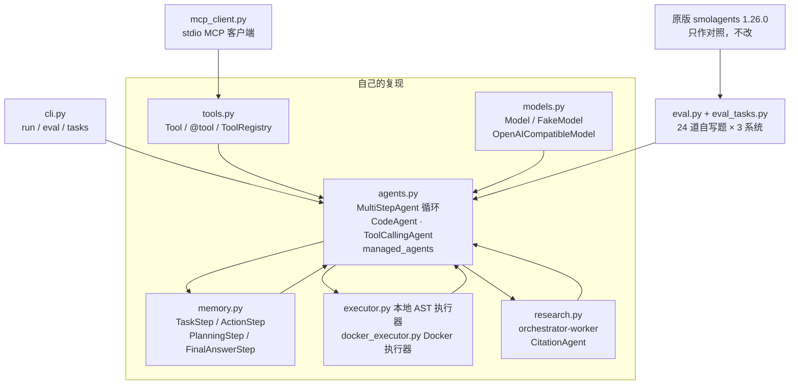

# smolagents 复现

一步一步复现 [HuggingFace smolagents](https://github.com/huggingface/smolagents)
1.26.0 的 CodeAgent：读上游源码，按自己的风格重写，不用
`pip install smolagents` 当黑盒。每步都有测试和联网验证。

**为什么复现它**：它是最小的完整 agent 框架——模型抽象、工具系统、
循环记忆、代码执行器、多智能体、沙箱、评测都在里面，而且核心
循环只有几百行，适合从零学透。演示场景是**多源网络研究 + 引用**
（不做风控审核，那是日常工作，复现它没意思）。

**自己的代码只用标准库**，零第三方依赖（`requirements.txt` 里的两个包
只供“原版对照”用）。

## 快速上手

```bash
git clone https://github.com/luminous1ming/smolagents-repro.git
cd smolagents-repro
python3 -m venv .venv
.venv/bin/pip install -r requirements.txt

# 离线演示（不用 key、不联网）：CodeAgent 跑一道算术评测题
.venv/bin/python cli.py run --eval arith-01 --agent code --model fake
# → 答案：432，结果：✅ 通过（1 步，0.0s）

# 看看全部 24 道评测题
.venv/bin/python cli.py tasks

# 全量评测（离线，三个系统 × 24 题）
.venv/bin/python cli.py eval --model fake
```

联网跑真模型（走 Gemini 免费层，key 从 Secure Vault 取，只放内存）：
```bash
EVAL_MODEL=gemini-2.5-flash .venv/bin/python cli.py run --task "算一下 128*46" --model live
# MCP 演示：接一个 MCP server 当工具源
EVAL_MODEL=gemini-2.5-flash .venv/bin/python cli.py run --task "用 mcp_calc 算 128*46" \
    --model live --mcp-command "python3 mcp_test_server.py"
```
免费层每天每模型 20 次调用，还有每分钟限流——批量联网评测要分批，
见 `notes/phase7-eval.md` 的分批计划。

## 架构



关键设计（和上游的异同，详见 `notes/architecture.md`）：

- **循环本身不拼消息**：`AgentMemory` 的步骤是历史的唯一来源，每步
  开始时由 `to_messages()` 重新序列化——历史 = 内存的投影。
- **CodeAgent 是核心**：模型每步写一段 Python，执行器跑它，print 输出
  + 表达式值拼成 Observation；一步能做多件事，所以步数比
  ToolCallingAgent 少一半以上。
- **本地执行器不是安全沙箱**（上游文档原话）：白名单导入 + 禁
  open()/dunder + 操作数上限能拦住模型误操作，拦不住有意绕过；
  不可信代码走 Docker 执行器（同接口，换对象就行）。
- **模型层自带重试**（上游没有）：超时/5xx 重试 3 次，2s→5s→10s
  退避；429 直接抛，不重试——这是从 mini-agent 的 A4 规则带过来的。
- **引用核查是确定性的**：CitationAgent 不调模型，只认 researcher
  交过的 `Sources:` 节，编出来的引用直接删掉。

## 各阶段做了什么

| 阶段 | 内容 | 测试 | 联网验证 |
|---|---|---|---|
| 0 | 基线：装原版 1.26.0，跑 README 例题，通读源码写架构笔记 | — | 豹子题 4 步正确（gemini-3.5-flash） |
| 1 | 模型抽象层（Model / FakeModel / OpenAI 兼容模型 + A4 重试） | 25/25 | 2.5-flash 消息形状一致 |
| 2 | 工具系统（`@tool` 从签名推导 schema，ToolRegistry） | 67/67 | 2.5-flash 调 calc 得 5888；发现 Gemini 端点不认 `"type": "any"` |
| 3 | MultiStepAgent + ToolCallingAgent（规划步、纠正 Observation、JSONL 日志） | 45/45 | 2.5-flash 2 步得 5888 |
| 4 | CodeAgent + AST 执行器（白名单导入、操作数上限、有状态命名空间） | 54/54 | 2.5-flash 1 步 1.0s 得 5888 |
| 5 | 多智能体 + Anthropic orchestrator-worker（并行 researcher + 引用核查） | 43/43 | 2.5-flash 3 次调用，4.1s，lead 派 researcher 算出 5888 |
| 6 | Docker 沙箱（和本地执行器同接口） | 45/45（+1 跳过） | 0 次调用；**真实隔离未验证，见下** |
| 7 | 评测：24 道自写题 × 3 系统 | 194/194 | 抽查 3 道（见下表） |
| 8 | 作品集打包：CLI + MCP 客户端 + 本 README | 20/20（MCP）+ 15/15（CLI） | CLI 跑通，见下表 |

全部 9 套自测（508 个断言）不联网，跑法见下。

## 评测结果

评测集：24 道自写题，算术/文件/研究各 8 道，答案都可核查
（`eval_tasks.py`）。研究题只打分事实对不对，引用准不准是
Phase 5 CitationAgent 的验收标准。

### FakeModel 全量（离线，24 题 × 3 系统）

| 系统 | 通过 | 平均步数 | 总 token | 429 |
|---|---|---|---|---|
| code（自己的 CodeAgent） | 24/24 | 1.0 | 16,023（假用量，按词数算） | 0 |
| toolcalling（自己的 ToolCallingAgent） | 24/24 | 2.4 | 24,362（假用量） | 0 |
| upstream（原版 smolagents CodeAgent） | 24/24 | 1.0 | 0（假模型不报用量） | 0 |

结论和 Phase 4 一致：CodeAgent 1 步能做完的事，ToolCallingAgent
要 2–4 步。但 FakeModel 的步数是“脚本最少步数”，真模型会多走纠正步。

### 联网抽查（gemini-2.5-flash，2026-11-21）

| 任务 | 系统 | 结果 | 步数 | token in/out | 耗时 |
|---|---|---|---|---|---|
| arith-01 | code | ✅ 432 | 2 | 2235/38 | 2.7s |
| file-01 | code | ✅ sum 65 → 130 | 2 | 2328/166 | 3.6s |
| research-02 | code | ❌ 429 | 0 | — | 4.5s |
| arith-01（Phase 8，CLI 跑） | code | ✅ 432 | 2 | 2235/38 | 2.7s |
| mcp_calc 算 128*46（Phase 8，CLI + MCP） | code | ✅ 5888 | 1 | 1211/28 | 1.3s |

两点值得记：真模型 2 步做完 FakeModel 1 步的题——提示词的规则 4
（依赖型调用先 print、下一步再用）会让模型分步，所以评测 max_steps
设 15；research-02 在 1 分钟内第 5 次调用就撞了 429——免费层不只有
每天 20 次的额度，还有每分钟限流，整轮联网跑必须带 `--sleep` 分批，
约 240–280 次调用，分 6–7 天跑完（计划见 `notes/phase7-eval.md`）。

## 诚实说明（没做到的事）

- **Docker 真实隔离没验证**：这台 VM 跑不起真容器——seccomp 拦住了
  setns，podman 装上了、镜像拉下来了，crun/runc 还是起不来。
  DockerExecutor 的命令构造、runner 逻辑、FakeRuntime 测试都通了，
  但“真容器能不能关住恶意代码”没证明。真容器测试在
  `tests_sandbox.py` 第 5 组，默认跳过，有 Docker 的机器上设
  `DOCKER_EXECUTOR_REAL_RUNTIME=podman`（或 docker）再跑。
  详见 `notes/phase6-sandbox.md`。
- **整轮联网评测没跑完**：额度只够抽查（上面 5 次调用）。24 题 × 3
  系统的完整对照表要等按计划分批跑完再补。
- **MCP 只验了离线 + 一次联网**：stdio 客户端、工具注册、CodeAgent
  调 mcp_calc 完成 arith-01 都验了；没试过 `npx` 的官方 server
  （那要另装 Node 工具链）。MCP 工具进不了 DockerExecutor（子进程
  在宿主机上，容器里没有它）——和 managed_agents 同款限制。
- **引用准确率还没进评测**：研究题目前只看事实对不对；CitationAgent
  的“引用必须指向真实来源”还没变成评测指标。

## 跑测试

```bash
.venv/bin/python tests_models.py       # Phase 1，25 个，不联网
.venv/bin/python tests_tools.py        # Phase 2，67 个，不联网
.venv/bin/python tests_agents.py       # Phase 3，45 个，不联网
.venv/bin/python tests_code_agent.py   # Phase 4，54 个，不联网
.venv/bin/python tests_multi_agent.py  # Phase 5，43 个，不联网
.venv/bin/python tests_sandbox.py      # Phase 6，45 个，不联网（另 1 个真容器测试默认跳过）
.venv/bin/python tests_eval.py         # Phase 7，194 个，不联网
.venv/bin/python tests_mcp.py          # Phase 8，20 个，不联网
.venv/bin/python tests_cli.py          # Phase 8，15 个，不联网
```

## 文件地图

| 路径 | 说明 |
|---|---|
| `cli.py` | Phase 8：命令行入口（run / eval / tasks；--agent / --model / --max-steps / --mcp-command） |
| `tests_cli.py` | Phase 8 自测（15/15，不联网） |
| `mcp_client.py` | Phase 8：stdio MCP 客户端（initialize / tools/list / tools/call → ToolRegistry） |
| `mcp_test_server.py` | Phase 8：测试用的 MCP server（mcp_calc / mcp_echo，不联网） |
| `tests_mcp.py` | Phase 8 自测（20/20，不联网；验收：CodeAgent 用 mcp_calc 完成 arith-01） |
| `requirements.txt` | 依赖：smolagents[openai]==1.26.0、ddgs==9.16.1（只供原版对照） |
| `models.py` | Phase 1：模型抽象层（Model / ChatMessage / FakeModel / OpenAICompatibleModel） |
| `tests_models.py` | Phase 1 自测 |
| `run_live_check.py` | Phase 1 联网检查（FakeModel vs 真模型比消息形状） |
| `run_phase0.py` | Phase 0：跑原版 smolagents 的 runner |
| `tools.py` | Phase 2：工具系统（Tool / @tool / schema 推导 / 校验 / ToolRegistry） |
| `default_tools.py` | Phase 2：默认工具（calc / read_file / write_file / web_search / final_answer） |
| `tests_tools.py` | Phase 2 自测 |
| `run_live_check_tools.py` | Phase 2 联网检查（真模型调 calc） |
| `eval_tasks.py` | Phase 7：评测集（24 道自写题：算术/文件/研究各 8 道）+ checker + FakeModel 假脚本 |
| `eval.py` | Phase 7：评测 harness（同一套题跑 code / toolcalling / upstream 三个系统，记成功率、步数、token、耗时、429；--limit/--offset/--tasks 分批，--sleep 轮间停顿） |
| `tests_eval.py` | Phase 7 自测 |
| `eval_runs/` | Phase 7：每轮评测的结果（results.json + summary.md + 各题 workdir + logs/） |
| `memory.py` | Phase 3：步骤记忆（TaskStep / ActionStep / PlanningStep / FinalAnswerStep，to_messages() 是历史的唯一来源） |
| `agents.py` | Phase 3：MultiStepAgent（循环、规划、步数上限、JSONL 日志）+ ToolCallingAgent；Phase 4：CodeAgent；Phase 5：managed_agents（子智能体即工具） |
| `research.py` | Phase 5：orchestrator-worker 研究流程（规划 → 并行 researcher → 综合 → CitationAgent 引用核查） |
| `tests_multi_agent.py` | Phase 5 自测 |
| `run_live_check_multi_agent.py` | Phase 5 联网检查（CodeAgent lead + researcher，3 次调用） |
| `executor.py` | Phase 4：本地 Python 执行器（白名单导入、禁 open()/dunder、操作数上限、墙钟超时、有状态命名空间、final_answer 靠异常传值） |
| `tests_code_agent.py` | Phase 4 自测 |
| `run_live_check_code_agent.py` | Phase 4 联网检查（真模型跑 CodeAgent，1 次调用） |
| `docker_executor.py` | Phase 6：Docker 执行器（和本地执行器同接口，容器隔离：断网、只读根文件系统、资源上限、去特权、nobody；工具源码序列化进容器；FakeRuntime 替身供测试） |
| `tests_sandbox.py` | Phase 6 自测（45/45，另 1 个真容器隔离测试默认跳过） |
| `tests_agents.py` | Phase 3 自测 |
| `run_live_check_agents.py` | Phase 3 联网检查（真模型跑完整循环，2 次调用） |
| `runs/` | 每轮的 JSONL 步日志（mini-agent 的格式） |
| `trajectories/` | Phase 0 原版跑出的轨迹 |
| `notes/` | 每阶段的架构/设计笔记 |
| `live_checks/` | 联网检查的 JSON 记录 |
| `data/` | 测试数据 |

## 后续可做的事（没排进这 8 个阶段）

- 整轮联网评测跑完，补三个系统的成功率/步数/token 对照表
  （计划在 `notes/phase7-eval.md`，约 240–280 次调用，分 6–7 天）。
- DockerExecutor 对照：文件题走 DockerExecutor 跑一遍，比步数/
  成功率/耗时——要有 Docker 的机器。
- 引用准确率进评测：研究题加一个“答案里的引用有多少指向真实来源”的指标。
- orchestrator 端到端联网验证（规划 1 + researcher 2–3×1–2 + 综合 1，
  约 5–7 次调用），可以当作一道研究题来跑。
- 开源仓库 triage：用 Phase 5 的 orchestrator 给一个仓库的
  issues/PRs 出 triage 简报（roadmap 里 Phase 8 的扩展项）。
- LangGraph 重写：把同一个 MultiStepAgent 循环用 LangGraph 的图表达一遍，
  对照两种编排方式（求职时有用，面试常问）。
